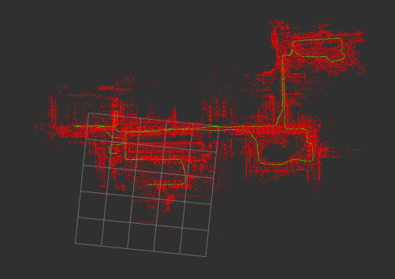

# lidar_localization_ros2

基于 **NDT 点云配准** 的 3D 激光雷达定位 ROS 2 (Humble) 功能包。

在已建好的点云地图（`.pcd`）上做**在线纯定位**（不更新地图），适用于 Ackermann 小车 + RoboSense 雷达的自动驾驶巡检平台，部署在 NVIDIA Orin。核心是 NDT scan-to-map 配准，并在其之上叠加了**里程计/IMU 预测 + 多重一致性门控状态机**，以应对走廊退化、静止漂移、误匹配回退等问题。



绿色：轨迹(path)，红色：地图(map)。

---

## 一、算法概述

整体是 “**预测 → NDT 配准 → 多重门控校验 → 接受/拒绝 → 发布 TF**” 的循环：

1. **点云预处理**：体素降采样（`voxel_leaf_size`）+ 距离裁剪（`scan_min/max_range`）；开启 `use_imu` 时先做运动去畸变。
2. **初值预测**：
   - 未锁定时用上一帧位姿作初值；
   - 已锁定 + `use_odom` 时用里程计增量外推：`T_pred = T_map_base_last * Δodom`，其中 `Δodom = odom_at_last_accept⁻¹ · current_odom`（以“上次成功接受帧”为基准，避免被拒帧累积误差）。
3. **NDT 配准**：当前点云与地图对齐，得到 `T_map_base`。
4. **状态机**：`INITIALIZING`（宽松阈值 `init_score_threshold`）连续成功 `localization_success_frame_num` 帧后锁定为 `TRACKING`（严格阈值 `score_threshold`）。
5. **多重门控**（见下表），结果通过才接受。
6. **TF 发布**：由 `T_map_base` 与 `odom→base` 反推 `map→odom`，并用独立定时器以 `map_odom_publish_rate` 高频重发，保证 TF 树连续。

### 门控/拒绝机制

| 门控 | 触发条件 | 处理 |
|---|---|---|
| 收敛 & fitness | NDT 未收敛或匹配分超阈值 | 硬拒绝 |
| 跳变门 (jump gate) | 相对预测的平移/yaw/z/roll-pitch 跳变过大 | 硬拒绝 |
| odom 一致性门 | NDT 位移/转角比里程计增量大太多 | 软拒绝 |
| 静止保护 | 车静止但 NDT 仍产生修正（防原地漂移） | 软拒绝 |
| 后退保护 | odom 前进但 NDT 算成后退（防误匹配回退） | 软拒绝 |

- **硬拒绝**：计入丢失计数，连续 `tracking_lost_frame_num` 帧后，按 `allow_tracking_lost_reinit` 决定是否退回 `INITIALIZING`。
- **软拒绝**：仅丢弃该帧 NDT 结果，保留上次有效位姿并维持 `TRACKING`（主要应对走廊/隧道几何退化）。

---

## 二、输入 / 输出

**订阅**

| 话题（默认） | 类型 | 说明 |
|---|---|---|
| `/rslidar_points` | `sensor_msgs/PointCloud2` | 雷达点云（`cloud_topic`） |
| `/map` | `sensor_msgs/PointCloud2` | 点云地图（`use_pcd_map=false` 时由外部发布） |
| `/initialpose` | `geometry_msgs/PoseWithCovarianceStamped` | 初始位姿（`set_initial_pose=false` 时需要，可用 RViz 给定） |
| `/odom` | `nav_msgs/Odometry` | 里程计，可选（`use_odom`） |
| `/imu` | `sensor_msgs/Imu` | IMU，用于点云去畸变，可选（`use_imu`） |

**发布**

| 话题 | 类型 | 说明 |
|---|---|---|
| `pcl_pose` | `geometry_msgs/PoseWithCovarianceStamped` | map 系下当前位姿 |
| `orin_pose` | `car_msg/OrinPose` | 供本项目其他节点使用的位姿 |
| `path` | `nav_msgs/Path` | 历史轨迹 |
| `initial_map` | `sensor_msgs/PointCloud2` | `use_pcd_map=true` 时发布加载的地图 |
| TF `map → odom` | tf2 | 定位结果（`odom → base_link` 由里程计提供） |

---

## 三、依赖

- ROS 2 Humble、PCL、`car_msg`（本工作区自定义消息）
- [ndt_omp_ros2](https://github.com/rsasaki0109/ndt_omp_ros2.git)（多线程 NDT/GICP）

---

## 四、编译与运行

```bash
# 在工作区根目录 /home/nvidia/auto_driving
colcon build --symlink-install --packages-select lidar_localization_ros2
source install/setup.bash

# 启动定位（含生命周期自动 configure + activate）
ros2 launch lidar_localization_ros2 lidar_localization.launch.py

# 可选：可视化
rviz2 -d src/localization/lidar_localization_ros2/rviz/localization.rviz
```

> launch 文件会自动完成 `configure → activate` 生命周期跳转。若没有 URDF / `robot_state_publisher`，需自行补 `base_link ↔ 雷达 frame` 的静态 TF。

启动后定位流程：
1. 加载 PCD 地图（`use_pcd_map=true`）或等待 `/map`；
2. 给定初始位姿（`set_initial_pose=true` 用参数，或 RViz 发 `/initialpose`）；
3. 连续配准成功若干帧后进入 `TRACKING`，开始稳定输出 `map→odom`。

---

## 五、参数说明

参数文件：`param/localization.yaml`

### 坐标系 / TF
| 参数 | 默认 | 说明 |
|---|---|---|
| `global_frame_id` | `map` | 全局坐标系 |
| `odom_frame_id` | `odom` | 里程计坐标系 |
| `base_frame_id` | `base_link` | 车体坐标系 |
| `map_odom_publish_rate` | 50.0 | `map→odom` 重发频率 [Hz] |
| `transform_tolerance` | 0.1 | TF 时间戳前向容差 [s] |

### 话题
| 参数 | 默认 |
|---|---|
| `cloud_topic` | `/rslidar_points` |
| `odom_topic` | `/odom` |
| `imu_topic` | `/imu` |
| `map_topic` | `/map` |
| `initialpose_topic` | `/initialpose` |

### 配准
| 参数 | 默认 | 说明 |
|---|---|---|
| `registration_method` | `NDT_OMP` | `NDT` / `GICP` / `NDT_OMP` / `GICP_OMP` |
| `score_threshold` | 1.0 | TRACKING 阶段 fitness 阈值 |
| `init_score_threshold` | 2.0 | INITIALIZING 阶段 fitness 阈值 |
| `ndt_resolution` | 0.55 | NDT 体素分辨率 [m] |
| `ndt_step_size` | 0.04 | NDT 最大步长 [m] |
| `ndt_max_iterations` | 60 | 最大迭代次数 |
| `ndt_num_threads` | 4 | NDT_OMP 线程数（0=最大可用） |
| `transform_epsilon` | 0.001 | 迭代收敛阈值 |
| `voxel_leaf_size` | 0.08 | 输入点云降采样尺寸 [m] |

### 点云范围
| 参数 | 默认 | 说明 |
|---|---|---|
| `scan_min_range` | 0.15 | 最近有效距离 [m] |
| `scan_max_range` | 10.0 | 最远有效距离 [m] |
| `scan_period` | 0.1 | 扫描周期 [s]（去畸变用） |

### 地图 / 初始位姿
| 参数 | 默认 | 说明 |
|---|---|---|
| `use_pcd_map` | true | 是否直接从 PCD 加载地图 |
| `map_path` | `/home/nvidia/ros2_ws/maps/map.pcd` | PCD 地图路径（注意核对实际路径） |
| `set_initial_pose` | false | 是否使用参数中的初始位姿 |
| `initial_pose_{x,y,z,qx,qy,qz,qw}` | — | 初始位姿（`set_initial_pose=true` 时生效） |

### 先验输入
| 参数 | 默认 | 说明 |
|---|---|---|
| `use_odom` | true | 是否用里程计做预测/校验 |
| `use_imu` | false | 是否用 IMU 做点云去畸变 |
| `enable_debug` | true | 调试日志 |

### 跳变门 (jump gate)
| 参数 | 默认 | 说明 |
|---|---|---|
| `reject_translation_threshold` | 0.80 | 相对预测平移跳变上限 [m] |
| `reject_yaw_threshold_deg` | 20.0 | yaw 跳变上限 [deg] |
| `reject_z_threshold` | 0.3 | z 跳变上限 [m] |
| `reject_roll_pitch_threshold_deg` | 8.0 | roll/pitch 跳变上限 [deg] |

### 状态机
| 参数 | 默认 | 说明 |
|---|---|---|
| `localization_success_frame_num` | 3 | 连续成功多少帧后锁定 TRACKING |
| `tracking_lost_frame_num` | 5 | 连续硬拒绝多少帧判定跟丢 |
| `allow_tracking_lost_reinit` | false | 跟丢后是否自动回 INITIALIZING（走廊场景建议 false） |

### odom 一致性门
| 参数 | 默认 | 说明 |
|---|---|---|
| `enable_odom_consistency_gate` | true | 开关 |
| `odom_consistency_trans_margin` | 0.20 | 允许的额外平移裕度 [m] |
| `odom_consistency_yaw_margin_deg` | 5.0 | 允许的额外 yaw 裕度 [deg] |

### 静止保护
| 参数 | 默认 | 说明 |
|---|---|---|
| `enable_static_ndt_reject` | true | 开关 |
| `static_odom_trans_threshold` | 0.01 | 判定 odom 静止的平移阈值 [m] |
| `static_odom_yaw_threshold_deg` | 0.3 | 判定 odom 静止的 yaw 阈值 [deg] |
| `static_ndt_trans_threshold` | 0.05 | 静止时允许的 NDT 平移修正 [m] |
| `static_ndt_yaw_threshold_deg` | 2.0 | 静止时允许的 NDT yaw 修正 [deg] |

### 后退保护
| 参数 | 默认 | 说明 |
|---|---|---|
| `enable_backward_reject` | true | 开关 |
| `backward_correction_threshold` | 0.05 | NDT 后退修正判定阈值 [m] |

---

## 六、代码结构

```
lidar_localization_ros2/
├── include/lidar_localization/
│   ├── lidar_localization_component.hpp   # 定位节点类声明
│   └── lidar_undistortion.hpp             # IMU 点云去畸变
├── src/
│   ├── lidar_localization_component.cpp   # 核心：配准 + 门控 + 状态机 + TF
│   └── lidar_localization_node.cpp        # 节点入口
├── launch/lidar_localization.launch.py    # 生命周期启动（自动 configure/activate）
├── param/localization.yaml                # 参数配置
└── rviz/localization.rviz                 # 可视化配置
```

---

## License

BSD 2.0（见 `LICENSE`）。基于 [rsasaki0109/lidar_localization_ros2](https://github.com/rsasaki0109/lidar_localization_ros2) 二次开发。
